# Processes

The following processes describe the steps to create, read, update and delete contents in the attachment entity.
The attachment entity itself is handled by the CAP stack as it is part of the data model.

The attachment service has the following events. This document describes how these events are emitted.

- `CREATE`
- `MARK AS DELETED`
- `READ`
- `RESTORE DELETED`

The following chapters describe the processes for user events and how they map to the attachment service events.

## Create

The following overview shows the process of creating a new content inside the attachment entity.

### Success

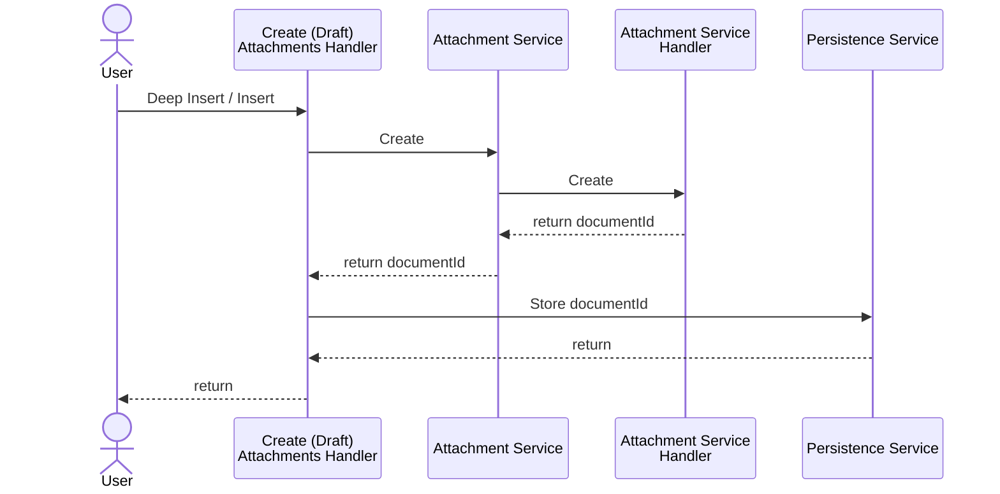

Independent of "draft" or "no draft" processes, the steps are the same; only the handlers differ.
The handlers listen to the event `CREATE` or `DRAFT_CREATE` and are executed when the event is triggered.

The handlers call the attachment service for the create event, and the attachment service handler
gets the stream and processes it.

### Error

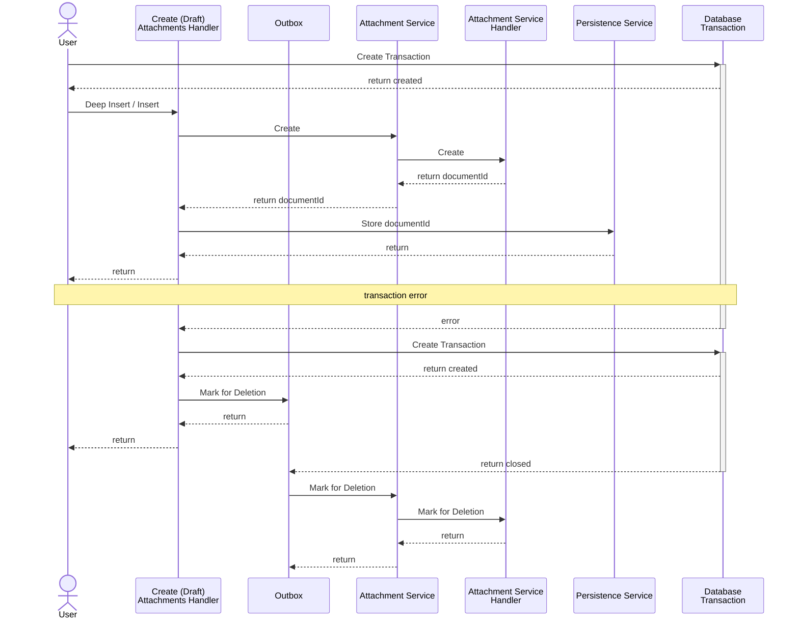

After an error occurs in the database transaction, the create handler creates a new transaction
and calls the outbox (attachment service as an outboxed service) to mark the newly created content as deleted.

After the transaction is finished, the outbox takes care of calling the attachment service for the "mark as deleted"
event.

## Delete

The following overview shows the process of deleting existing content inside the attachment entity.

The behaviour depends on the storage backend:

- **Database storage:** the attachment row is deleted directly by the CAP framework.
  There is no soft delete. The restore endpoint does nothing for this backend.
- **Filesystem storage:** the content directory is moved to a `deleted/` folder rather than
  removed. The restore endpoint does not recover this content — the restore handler is a no-op
  for this backend. Recovery requires a manual filesystem operation.
- **Object store (OSS) storage:** the code issues a plain delete request to the bucket.
  Whether this results in a soft delete depends on the bucket configuration.
  If the bucket has versioning enabled, the delete places a delete marker and the content
  remains recoverable. In that case, a database restore can be made consistent with the bucket
  state by finding the matching bucket version.

In the case of a draft, the delete handler is not called. It is only called when the draft is activated.
If deletion were also called for a draft that is later cancelled, the content could not easily be restored or unmarked.

### Success

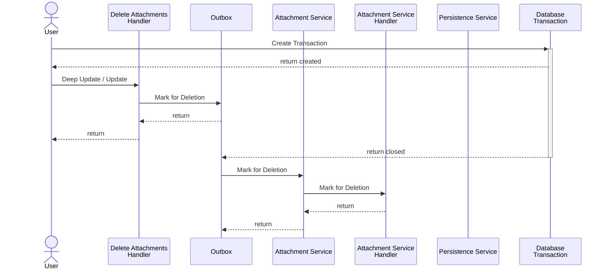

The delete handler calls the outbox (attachment service as an outboxed service) to mark the content as deleted.
After the transaction is finished, the outbox takes care of calling the attachment service for the "mark as deleted"
event.

### Error

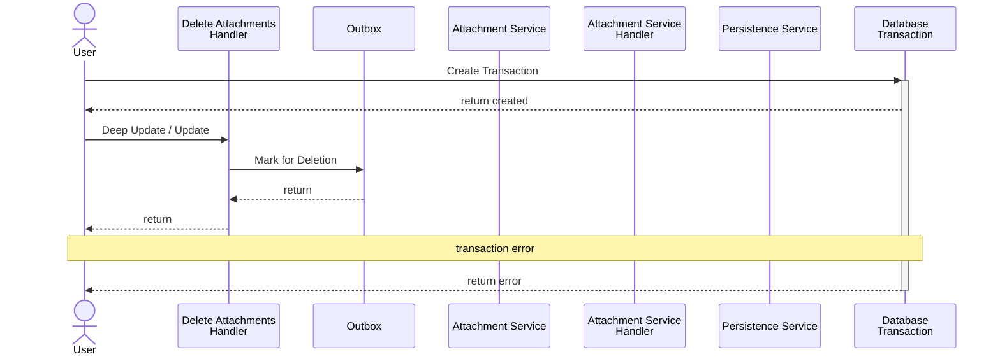

After the error occurs, the outbox entry is rolled back, so the attachment service is never called
for "mark as deleted" and nothing needs to be done.

## Update

The following overview shows the process of updating existing content inside the attachment entity.
The attachment service does not support an update, as this would be very difficult in terms of transactional
consistency.

### Success

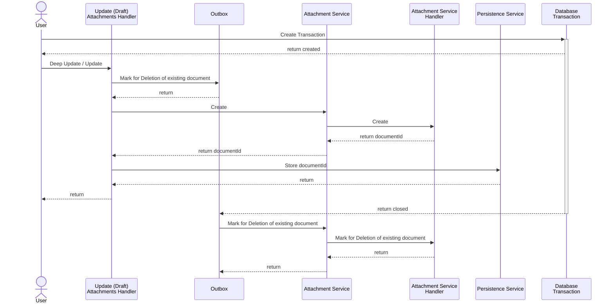

The update is implemented as a delete and new create process.
First, the outbox is called to mark the existing content as deleted.

After that, the attachment service is called for the create event.

### Error

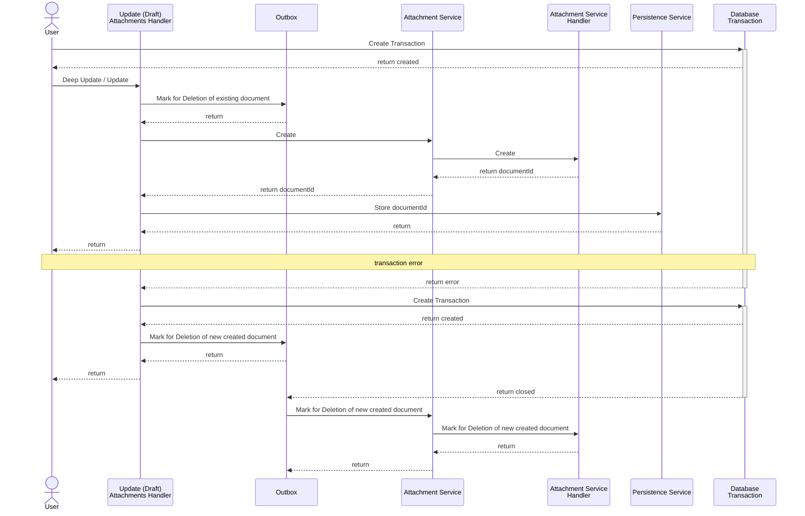

In case of errors and rollback of the database transaction, the outbox entry for the deletion mark of the existing content
is not persisted, so nothing needs to be done.
For the newly created content, the outbox must be called to mark the content as deleted.

## Draft

Attachments are draft-enabled. This means that attachments can be created, updated, and deleted in draft mode.
In draft mode, attachments are created and the attachment service is also called for the create event.
The process for creation is the same as for the [create event](#create).

The same is true for the update event. The process for the update event is the same as for the [update event](#update).

The delete event is not called for drafts. The delete event is only called when the draft is activated.
For this, only the content ID is deleted in the draft attachment entity.
When the draft is activated, the delete event is called for the content ID.

### Activate Draft

During activation of the draft, the attachment entity is read, and for every content ID that
is deleted in the draft entity but present in the active entity, the delete event is called.

### Cancel Draft

If a draft is cancelled, the attachments created in the draft entity are deleted.
Cancelling a draft is the same as a deep delete.
The process for deleting content is the same as for deletion, but handled in a discard draft handler.

### Readonly Fields

The following fields are readonly:

- `status`
- `scannedAt`
- `contentId`

As the current implementation of the draft activation in the CAP Java stack does not copy readonly fields to the
active entity, some special logic needs to be implemented to preserve the readonly fields.

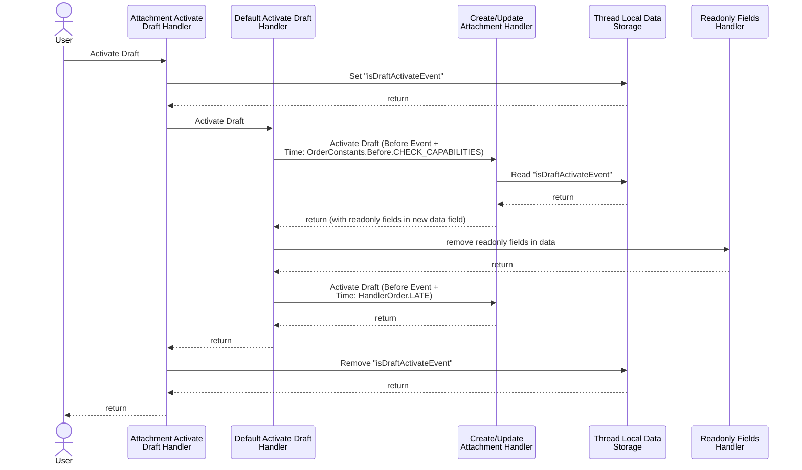

In the `CreateAttachmentHandler` and in the `UpdateAttachmentHandler`, the readonly fields are stored in the event data
of the attachment entity under the key `CREATE_READONLY_CONTEXT`, but only when the process is a draft activation.
Otherwise, the key `CREATE_READONLY_CONTEXT` is cleared to prevent these fields from being set externally.

The handlers are called again after the readonly fields are removed and can use the readonly fields from the
storage under key `CREATE_READONLY_CONTEXT`. The readonly fields are copied back into the data so that they are stored
in the database.

The handlers are called twice so that the logic runs at a late point in time, after validations have been executed.

## Restore Deleted Content

The attachment service defines a `RESTORE_DELETED` event and exposes an endpoint that accepts
a timestamp as input. The intent is that every content marked as deleted after the given timestamp
would be restored.

However, none of the built-in storage backends implement this event — the restore handler is a
no-op in the database, filesystem, and OSS backends. The event exists as an extension point for
custom `AttachmentService` handler implementations, such as one backed by SAP Document Management
Service (DMS), which may have its own recycle bin or versioning concept.

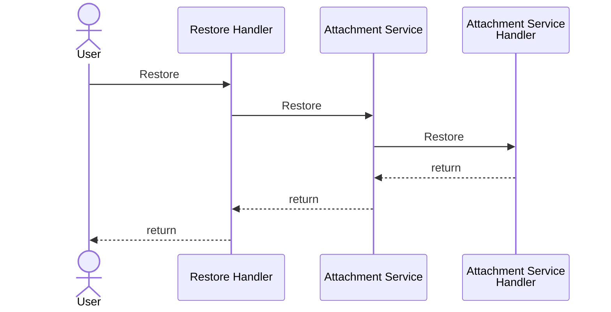

## Malware Scan

For uploaded content, a malware scan is required.
Depending on the attachment service handler implementation and the storage of the content, the malware scan can be done
in different ways.

For example, the SAP Content Management Service (DMS) scans the content on upload.
For content stored in the database, the malware scan must be called as an external service.
To avoid poor performance for this call, the malware scan is called asynchronously.

Because the malware scan depends on the attachment service handler implementation, it is called in the handler and not
before calling the attachment service.

### Status

The attachment entity has a field `status` that indicates the scan status of the content.
The default value is `Unscanned`.
All possible status values are:

- `Unscanned` - Content has not been scanned yet
- `Scanning` - Content is currently being scanned
- `Clean` - Content was scanned and found to be clean
- `Infected` - Content was scanned and found to be infected
- `Failed` - An error occurred during scanning

### Database Storage

For the default attachment service implementation using database storage, the malware scanner is
called during the create event.
The malware scanner is an outboxed service, so scanning is triggered but executed asynchronously after the
current transaction is closed.

The service reads the attachment entity and, using the content ID, retrieves the content via the attachment service.
After that, the external malware scanner is called and the status of the content is updated.

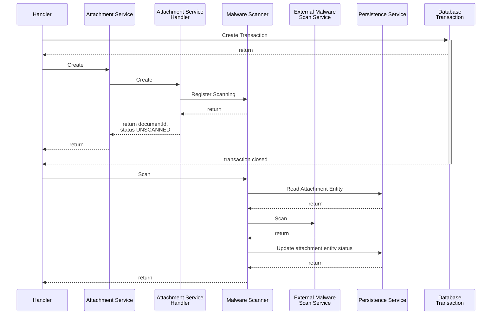

If there is no external scanner available, the status will be set to `Clean` (since there is no scanner to detect issues).

## Read

Because some consumers of the read event — e.g. the OData V4 adapter — need to know whether
content is available in order to show a link on the UI, and they need this information in the content field, a proxy for
the `InputStream` was created.
The attachment handler does not return the `InputStream` directly; it returns a proxy object that
forwards the call to the attachment service when the bytes of the input stream are requested.

With this, the content field is always populated with a stream object, but a request to external storage is
not always made.

The proxy can also handle the status check of the attachment entity.
This check is implemented in the proxy for the following reasons:

- the check is not implemented in the read attachments handler, because if no access is needed — e.g. for showing the link
  on the UI — no error is thrown and the user sees the link. Without the link, users might wonder why there is no
  link even though they uploaded content
- if the bytes of the stream are accessed, an exception is thrown and potentially problematic content is not shown
  to the user
- the check is not implemented in the attachment service because:
    - every implementation of the attachment service handler would need to implement the check
    - the malware scanner needs to read the content without the check, because it needs the stream to scan the content

### Read including Access to the Content

The following sequence diagram shows the process of reading a content including access to the attachment service.

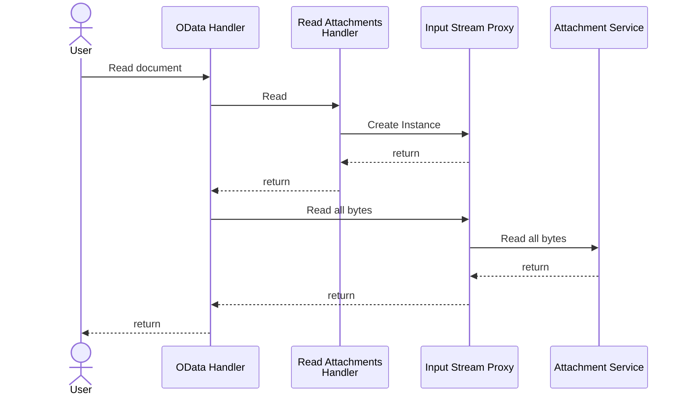

### Read without Access to the Content

The following sequence diagram shows the process of reading a content without access to the attachment service.

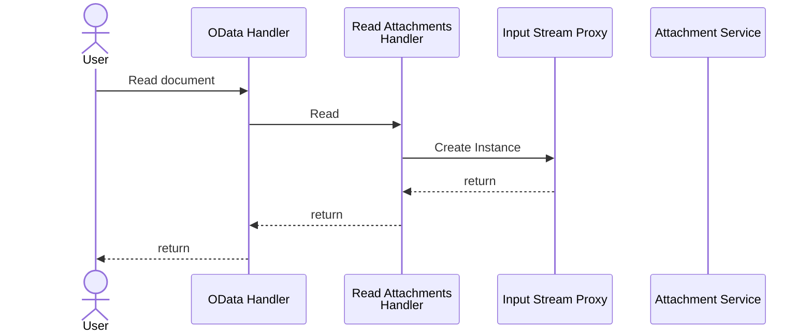

### Error because of Malware Scan Status

The following sequence diagram shows the process of reading a content with an error because of the malware scan status.

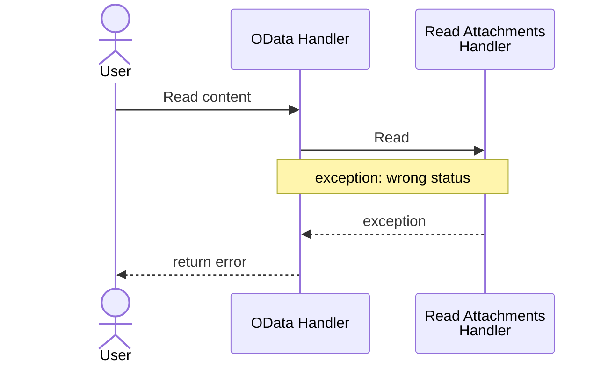

### No Scanner Available

If there is no malware scanner available because there is no dependency on the malware scanner service,
the status will be set to `Clean`.

Note: With a scanner available, content in `Unscanned` or `Scanning` status cannot be accessed until scanning completes.
